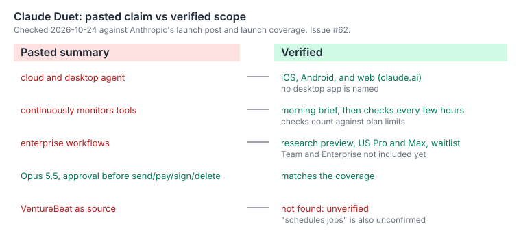

# Schema

| Item | Verified | Pasted wording that was wrong |
| --- | --- | --- |
| Platforms | iOS, Android, and web (claude.ai). No desktop app is named.[^anthropic] | "cloud and desktop agent" |
| Cadence | A morning brief, then checks of connected apps every few hours. Checks count against plan limits.[^coverage] | "continuously monitors" |
| Access | Research preview, US Pro and Max, waitlist. Team and Enterprise are not included yet.[^coverage] | "enterprise workflows" |
| Model | Opus 5.5 | none found |
| Approval | Asks before it sends, pays, signs, or deletes. Does not trade securities or move money between accounts.[^anthropic] | none found |

# Unverified

- That Duet "schedules jobs" for the user. No source confirms it.
- The VentureBeat article named in a pasted summary. It was not found. The Anthropic post is the primary source.

# Insight

Duet is a personal and professional app in research preview. It is not an enterprise product yet, and it polls on a schedule instead of watching all the time. Cite this page, not the pasted wording.

# Tracking

Fact check: [issue #49 comment](https://github.com/mykie2015/agendum/issues/49#issuecomment-6377492969). Work item: [issue #62](../issues/62-add-a-verified-scope-table-for-claude-duet-to-the-wiki.md). Vault page: `02.wiki/research/claude-duet-launch-pulse.md`.

[^anthropic]: Introducing Claude Duet, Anthropic, 2026-10-21.
[^coverage]: Launch coverage, 2026-10-21: MacRumors, Thurrott, iPhone in Canada. They agree on these points; which outlet states each one was not recorded.
