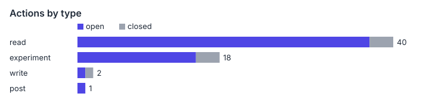
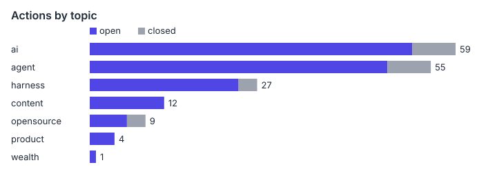

# Agendum wiki

What the 61 Agendum actions (54 open) add up to. Insight pages make claims across related issues; issue pages are the evidence ledger. Format: Open Knowledge Format v0.2.

# Insights

* [Where harness changes do raise accuracy, the mechanism is an independent check against real state](insights/accuracy-gains-come-from-an-independent-second-look.md) - Handoffs, contrastive probes, sub-agent verification and positive controls all gain from a second look at actual files or behavior, not from more orchestration. A fresh context alone helped in one study. (confidence: medium-low; issues: #28, #34, #12, #5, #14)
* [At a strong base model, the harness is mostly a cost lever, not an accuracy lever](insights/harness-is-a-cost-lever-at-a-strong-base.md) - Across five harness studies, elaborate harnesses add no accuracy at a strong base but change cost by tens of percent. Accuracy gains appear where the harness content is edited or a second pass checks the work. (confidence: medium-low; issues: #14, #28, #40, #34, #29, #12, #5, #7)
* [Scope words and multipliers inflate between a vendor's text and its retellings](insights/launch-claims-inflate-between-source-and-retelling.md) - In three checked cases, a retelling claimed more than the primary source: Duet's scope, xerj's 40x, and a 1/83 cost claim. Check scope words and multipliers against the first-hand text before quoting. (confidence: medium-low; issues: #62, #49, #10, #7)
* [A proactive agent is defined by where its approval boundary sits and what happens when it fails](insights/proactive-agents-are-defined-by-their-approval-boundary.md) - Vendors draw the line at irreversible actions and money. In this tracker the gate fails in three places: the user approves too broadly, the agent never asks, or the monitor is weaker than claimed. (confidence: medium; issues: #49, #62, #44, #13, #17, #35, #37, #42, #53, #57)
* [Verification, not generation, is now the bottleneck, and vendors answer by moving the review](insights/verification-is-the-bottleneck-not-generation.md) - Agents write faster than people can review. Evidence from Anthropic, a Harvard paper and PostgreSQL shows review time rising, and three different answers: verify intent, prove properties, or hand unreviewed reports to the receiver. (confidence: medium; issues: #2, #15, #20, #25, #41, #54, #56)

Issues not yet synthesized into an insight: 35 of 61. List: [insights/index.md](insights/index.md).

# Evidence and views

* [Open action queue](queue.md) - open actions by priority with the next step
* [All actions](issues/index.md) - one page per issue (61)
* [ai](topics/ai.md) - 59 actions
* [agent](topics/agent.md) - 55 actions
* [harness](topics/harness.md) - 27 actions
* [content](topics/content.md) - 12 actions
* [opensource](topics/opensource.md) - 9 actions
* [product](topics/product.md) - 4 actions
* [wealth](topics/wealth.md) - 1 actions

# Concepts

* [Claude Duet Verified Scope](concepts/claude-duet-verified-scope.md) - What Anthropic's Claude Duet is and is not at launch: iOS/Android/web app, checks every few hours, US Pro and Max waitlist only.

